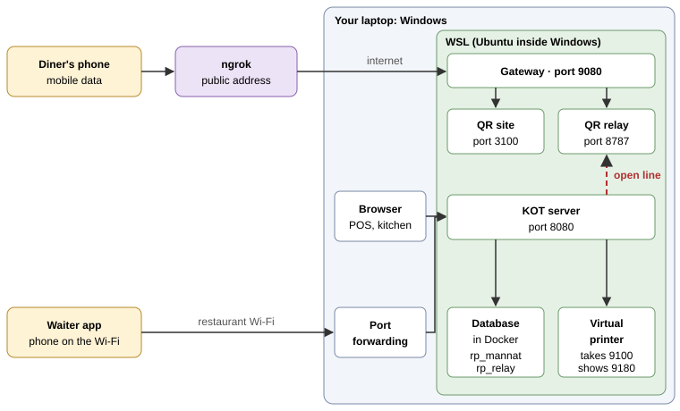

# Running and testing the Parosaa pilot

A step-by-step guide for testing three things on one Windows laptop:

- **QR ordering:** a diner scans a table's QR code on mobile data and places an order.
- **The waiter app:** an Android phone taking orders over the restaurant's Wi-Fi.
- **The virtual printer:** kitchen tickets and bills that appear in your browser instead of on paper.

You do not need to know how any of this is built. Read sections 1 to 3 once, then follow section 4.

To run the QR site on your own cloud server instead of ngrok, see
[manual task 38](../../manual-tasks/38-qr-pilot-server.md).

## 1. How it fits together

Parosaa is the name of the product and also of the pretend restaurant used for testing. The test
restaurant has 5 tables, a menu and staff.



### The pieces

| Piece               | Port          | What it is, in plain words                                                                          |
| ------------------- | ------------- | --------------------------------------------------------------------------------------------------- |
| **KOT server**      | 8080          | The restaurant's brain. The POS, kitchen screen and manager pages all come from here.               |
| **Database**        | none          | Where everything is stored. It runs inside Docker, in a sealed box of its own.                      |
| **QR relay**        | 8787          | The go-between that carries diners' orders from the internet to the laptop.                         |
| **QR site**         | 3100          | The web page diners see after scanning a table's code.                                              |
| **Gateway**         | 9080          | Puts the QR site and the relay behind one door, so ngrok needs only one address.                    |
| **ngrok**           | none          | A service that lends your laptop a temporary public internet address.                               |
| **Waiter app**      | none          | The Android app waiters use. It talks to the KOT server on port 8080 over the Wi-Fi.                |
| **Virtual printer** | 9100 and 9180 | Pretends to be a thermal printer. It receives tickets on 9100 and shows them on a web page on 9180. |

A **port** is like a numbered door on the computer. Each program listens at its own door.

**Why the browser shows a certificate warning.** The KOT server encrypts its connection using a
certificate the restaurant made for itself. Your browser does not know that maker, so it warns you.
The connection is still encrypted. For this test it is safe to continue. You only need to accept it
once per browser.

**What is in the database.** Docker holds two databases:

- `rp_parosaa` is the restaurant's own records: the menu, tables, staff and their PINs, orders,
  kitchen tickets, bills, payments and the list of devices.
- `rp_relay` is the go-between's small store: a copy of the menu and table codes, plus diners' orders
  on their way to the restaurant.

**Why the laptop keeps a line open to the relay.** Nobody on the internet can reach a laptop on
home or restaurant Wi-Fi, because the router blocks visitors from outside. Connections going out are
allowed, though. So the KOT server calls the relay itself and keeps that call open. When a diner
orders, the relay passes the order down that open line, within about a second. In the diagram it is
the red dashed line.

**Why the ngrok address might change.** ngrok lends your laptop its public address only while ngrok
is running. A current free ngrok account normally keeps the same address each time. If yours ever
changes, the script tells you, and any QR codes you printed earlier stop working until you print new
ones. Only the QR site and relay go through ngrok. The POS and manager pages are never put on the
internet.

**WSL and why phones cannot reach it on their own.** WSL is Ubuntu Linux running inside Windows, and
all the programs above run there. WSL has its own private network inside the laptop. A phone can see
Windows on the Wi-Fi, but it cannot see inside WSL. **Port forwarding** is a rule telling Windows:
"anything arriving at this door, pass on to WSL". Without it, phones see nothing.

**What is built into the waiter app.** Two things: the laptop's Wi-Fi address and a fingerprint of
the restaurant's certificate. The address tells the app where to look. The fingerprint lets it
check it has found the right laptop. Neither is a secret. Normally a manager must pair every phone
with a one-time code. In this pilot the phone pairs itself, as explained next.

### PIN-only sign-in

Normally a device must be approved by a manager before anyone can use it. **PIN-only** switches that
approval off: any phone or browser on the network connects by itself, and a 4-digit PIN is the only
protection.

**Never use PIN-only at a real restaurant.** Anyone who joins the Wi-Fi, including a customer on the
guest network, would get the sign-in screen and could try PINs against the till. It exists only to
make testing easy.

### The `.pilot` folder

The scripts keep everything about this test in a hidden folder called `.pilot`, inside the project.
It is never uploaded to GitHub.

| What                                                                           | Secret? |
| ------------------------------------------------------------------------------ | ------- |
| `server.env`, `relay-host.env`, `provision.env`: settings, including passwords | **Yes** |
| `pg-password`: the database password                                           | **Yes** |
| `relay-credential.txt`: the laptop's key to the relay                          | **Yes** |
| `server-data/`: the certificate and the keys that protect PINs                 | **Yes** |
| `parosaa.txt`: the staff PINs and each table's link                            | Private |
| `parosaa-tents.pdf`: the printable table cards with QR codes                   | No      |
| `pilot-ip`, `printer-mode`, `tents-url.txt`: what the scripts remember         | No      |
| `logs/`, `printouts/`, `photos/`, `apk/`                                       | No      |

Do not share the secret files or paste them into a chat.

## 2. This is separate from the dev setup

You may have used the developer setup earlier, started with `pnpm --filter @rp/server dev`. It is
a different restaurant with a different database (`rp_dev` by default; this laptop's settings use
`rp_fresh`). This pilot uses `rp_parosaa` and `rp_relay` instead, so neither touches the other's data.

**They cannot run at the same time, because both use port 8080.** If you try, the pilot refuses to
start and says which program holds the port.

| Logins        | Dev setup         | This pilot            |
| ------------- | ----------------- | --------------------- |
| Owner, 1111   | Asha (Owner)      | **Owner (Parosaa)**   |
| Manager, 2222 | Vikram (Manager)  | **Manager (Parosaa)** |
| Manager, 3333 | Neha (Manager)    | (none)                |
| Waiter, 4444  | Ravi              | **Waiter 1**          |
| Waiter, 5555  | Sunita            | **Waiter 2**          |
| Kitchen, 6666 | Chef Imran (note) | **Kitchen**           |

There is no cashier role any more. Managers take payments. Note: in the dev setup the kitchen screen
normally runs without a personal sign-in, so Chef Imran's PIN is refused unless individual kitchen
logins are turned on. In this pilot, Kitchen signs in with 6666.

### Switching from the pilot to the dev setup

**Window: Ubuntu**

```bash
cd ~/kot2.0
scripts/pilot/parosaa-local.sh stop
pnpm --filter @rp/server dev
```

- **What it does:** stops the whole pilot, then starts the developer server.
- **Why:** both need port 8080, so only one can run.
- **What happens:** the pilot's programs and database stop. No data is lost. The dev server then
  runs in this window and takes about 20 seconds to get going.
- **It worked if you see:** `Everything is stopped.` and then `Nest application successfully started`.
- **If it fails:** a message about a database usually means the laptop's own PostgreSQL is off. Run
  `sudo service postgresql start` and try again.

### Switching back to the pilot

Press **Ctrl+C** in the dev server's window to stop it. Then run the `start` command in section 4B.

## 3. Which window?

Every command below is labelled with the window it belongs in. Using the wrong one is the most common
mistake.

| Label                          | How to open it                                                                                                                  |
| ------------------------------ | ------------------------------------------------------------------------------------------------------------------------------- |
| **Ubuntu**                     | Start menu, type `Ubuntu`, press Enter. The prompt ends with `$`.                                                               |
| **PowerShell (Administrator)** | Start menu, type `PowerShell`, right-click it, choose **Run as administrator**, then **Yes**. The title bar says Administrator. |

**To paste into a window:** right-click inside it. Press Enter to run the command. Ubuntu may ask
for your Linux password in some cases, and it does not show the letters as you type.

**"Not run by Claude"** marks steps that need your phone or Administrator rights, which Claude could
not do itself. They were checked against the code instead. Everything else was actually run on this
laptop. Section 8 has the details.

## 4. Step by step

### 4A. First-time setup

Do these once, in order. Docker must already be running.

#### Step 1: go to the project folder

**Window: Ubuntu**

```bash
cd ~/kot2.0
```

- **What it does:** moves this window into the project folder.
- **Why:** every other command is written from this folder.
- **What happens:** nothing starts or changes. It is instant.
- **It worked if you see:** the prompt now shows `~/kot2.0`.
- **If it fails:** `No such file or directory` means the project is somewhere else. Ask whoever set
  up the laptop.

Do this each time you open a new Ubuntu window.

#### Step 2: build and set up the restaurant

**Window: Ubuntu**

```bash
scripts/pilot/parosaa-local.sh setup
```

- **What it does:** builds all the programs and creates the Parosaa test restaurant.
- **Why:** nothing can run until this has been done.
- **What happens:** takes about 3 to 10 minutes. It starts the database in Docker, finds the laptop's
  Wi-Fi address and remembers it, builds the programs, and creates the staff, menu and 5 tables with
  their QR codes. It creates the `.pilot` folder and puts a small file called `kot-ports.ps1` in your
  Windows user folder. Running it again is safe. It keeps your test data.
- **It worked if you see:** `Set up finished. Now: scripts/pilot/parosaa-local.sh start`.
- **If it fails:**
  - `Docker is not running`: start Docker, as in section 6, and run it again.
  - `Port` or `network` errors during the build: check the internet and run it again.

**Run this again whenever the software is updated**, otherwise you are testing old screens.

If you tested the earlier restaurant called Mannat on this laptop, this step creates a new Parosaa
restaurant beside it, with new QR codes. Print the new ones. The old restaurant is simply no longer
used.

#### Step 3: let phones reach the laptop

**Window: PowerShell (Administrator).** Not run by Claude.

```powershell
powershell -ep bypass ~\kot-ports.ps1
```

- **What it does:** sets up port forwarding and opens the Windows firewall for the pilot.
- **Why:** otherwise phones on the Wi-Fi cannot reach anything inside WSL, and the laptop's Wi-Fi
  address does not lead to the relay either.
- **What happens:** takes about 5 seconds. It finds the Wi-Fi and WSL addresses, removes any old
  forwarding, forwards ports 8080, 3100 and 8787, and adds a firewall rule called `KOT-pilot`.
- **It worked if you see:** `Finished. Phones on this Wi-Fi can reach this computer at` followed by
  your address.
- **If it fails:**
  - `This needs Administrator rights`: the window is not an Administrator one. See section 3.
  - `cannot be loaded` or `not found`: run `scripts/pilot/parosaa-local.sh ports` in Ubuntu to put the
    file back, then try again.

**Run this again after every Windows restart**, because the address of WSL changes each time.

To remove the forwarding and firewall rule when you have finished testing:

**Window: PowerShell (Administrator).** Not run by Claude.

```powershell
powershell -ep bypass ~\kot-ports.ps1 -Remove
```

- **What it does:** takes away what the previous command added.
- **Why:** to leave Windows as it was once testing is over.
- **What happens:** the forwarding and firewall rule are deleted. Nothing else changes.
- **It worked if you see:** `Removed. Phones can no longer reach the pilot on this computer.`
- **If it fails:** the same two reasons as above.

#### Step 4: start everything

**Window: Ubuntu**

```bash
scripts/pilot/parosaa-local.sh start
```

- **What it does:** starts the relay, the QR site and the KOT server in the background.
- **Why:** these are the programs you are testing.
- **What happens:** takes about 15 seconds. The database and three programs start. They keep running
  after you close the window. Their settings are rewritten from what the scripts remember.
- **It worked if you see:** `server: running`, `qr-site: running` and `relay-host: running`. A
  `"restaurantsOnLine":0` here is normal for the first minute.
- **If it fails:** `Port 8080 is already in use` means the dev server is on, so see section 2. For
  anything else, run `doctor` (next step).

#### Step 5: check everything

**Window: Ubuntu**

```bash
scripts/pilot/parosaa-local.sh doctor
```

- **What it does:** checks everything a test needs and says in plain words what to fix.
- **Why:** it finds most problems in seconds.
- **What happens:** takes about 10 seconds and only looks, so it changes nothing.
- **It worked if you see:** `All good: nothing to fix.`
- **If it fails:** each `FIX` line says what is wrong, with the command to run below it.

#### Step 6: sign in on the laptop

Open **https://localhost:8080** in Chrome or Edge on the laptop. At the warning, choose **Advanced**,
then **Proceed to localhost**. Tap **Manager (Parosaa)** and enter **2222**. You should see the
**Manage** page with **Floor** and tables 1 to 5.

### 4B. Everyday start and stop

**To start, after the laptop has been restarted:**

1. Make sure Docker is running.
2. Run the forwarding command from Step 3 (**PowerShell (Administrator)**).
3. Run `start` and then `doctor`, from Steps 4 and 5 (**Ubuntu**).

**To see what is running at any time:**

**Window: Ubuntu**

```bash
scripts/pilot/parosaa-local.sh status
```

- **What it does:** lists what is running and the current addresses.
- **Why:** a quick look, shorter than `doctor`.
- **What happens:** about 5 seconds. Only looks.
- **It worked if you see:** `server: running`, and a line starting `QR codes:` that says `Wi-Fi only`
  or `through ngrok`.
- **If it fails:** `stopped` next to a name means that program is off. Run `start`.

**If the laptop's Wi-Fi address has changed** (`doctor` will tell you, and it is common when you
reconnect):

**Window: Ubuntu**

```bash
scripts/pilot/parosaa-local.sh wifi
```

- **What it does:** finds the laptop's current Wi-Fi address and moves everything onto it. It also
  ends ngrok if ngrok was on.
- **Why:** QR codes and phones use that address, so it must be right.
- **What happens:** about 15 seconds. The three programs restart. The saved address, settings and
  `parosaa-tents.pdf` are updated. No test data is deleted.
- **It worked if you see:** `QR codes: Wi-Fi only` and the new address in the list.
- **If it fails:** if the address cannot be detected, give it yourself:
  `scripts/pilot/parosaa-local.sh wifi 192.168.1.20`.

After this, repeat Step 3. Then rebuild the waiter app, or type the new address into it (section 6).

**To stop everything:**

**Window: Ubuntu**

```bash
scripts/pilot/parosaa-local.sh stop
```

- **What it does:** stops all the pilot's programs, ngrok and the database.
- **Why:** to free up the laptop, or before switching to the dev setup.
- **What happens:** about 10 seconds. No data is deleted.
- **It worked if you see:** `Everything is stopped.`
- **If it fails:** run it a second time.

### 4C. QR ordering through ngrok

Run this with everything started (4A or 4B).

#### Step 1: install ngrok (once)

**Window: Ubuntu**

```bash
scripts/pilot/parosaa-ngrok.sh install
```

- **What it does:** downloads the ngrok program.
- **Why:** ngrok is what gives your laptop a public address.
- **What happens:** one or two minutes. A single file is saved in `~/.local/bin`.
- **It worked if you see:** `Installed: ngrok version`.
- **If it fails:** check the internet and run it again.

#### Step 2: connect your ngrok account (once)

Create a free account at [ngrok.com](https://ngrok.com), then copy your token from
[dashboard.ngrok.com/get-started/your-authtoken](https://dashboard.ngrok.com/get-started/your-authtoken).

**Window: Ubuntu.** Not run by Claude.

```bash
scripts/pilot/parosaa-ngrok.sh token PASTE_YOUR_TOKEN_HERE
```

- **What it does:** saves your ngrok token on this laptop.
- **Why:** ngrok only lends addresses to signed-in accounts.
- **What happens:** instant. It writes one ngrok settings file. Keep the token private.
- **It worked if you see:** `Authtoken saved to configuration file`.
- **If it fails:** check you copied the whole token.

#### Step 3: turn ngrok on

**Window: Ubuntu.** The scripts were run by Claude with a stand-in for ngrok, as there was no account.

```bash
scripts/pilot/parosaa-ngrok.sh
```

- **What it does:** gives the QR site and relay a public address.
- **Why:** so a diner on mobile data can reach them.
- **What happens:** about 20 seconds. The gateway and ngrok start, then the relay, QR site and server
  restart using the public address. `parosaa-tents.pdf` is rewritten if the address is new.
- **It worked if you see:** `Public address:` and a list of tables, each with a link.
- **If it fails:** `ERR_NGROK_4018` means the token is missing, so do Step 2. If ngrok says your
  account is already online somewhere, close the other ngrok and run this again.

To see the links again later:

**Window: Ubuntu**

```bash
scripts/pilot/parosaa-local.sh links
```

- **What it does:** lists each table's current link.
- **Why:** so you can open a table without a printed QR code.
- **What happens:** a second or two. It only reads.
- **It worked if you see:** `Table 1:` and so on, each followed by a link.
- **If it fails:** run `start` first.

#### Step 4: test it

Use a phone on **mobile data with Wi-Fi off**, which proves the order really travelled through the
internet. Get the QR codes from **Manage → QR codes**, or send yourself a link from `links`.

Open a second browser window on the laptop and sign in as **Kitchen** (6666) for step 7. Keep the
**POS** tab open as Manager.

| #   | Do this                                                                        | You should see                                                                       | What's happening behind the scenes                                                                                 |
| --- | ------------------------------------------------------------------------------ | ------------------------------------------------------------------------------------ | ------------------------------------------------------------------------------------------------------------------ |
| 1   | Scan a table's code. If ngrok shows a warning page, tap **Visit Site**.        | `Welcome to Parosaa`, `You're at table 2`                                            | Phone → ngrok → gateway → QR site. The table comes from the code itself.                                           |
| 2   | Type a mobile number and tap **Start ordering**.                               | The menu                                                                             | The QR site gets the menu from the relay, which holds a copy sent by the laptop.                                   |
| 3   | Tap **ADD** on two dishes. (**CHOOSE** means the dish has options.)            | A bar saying `2 items` and **View order**                                            | Nothing has been sent. The cart is only on the phone.                                                              |
| 4   | Tap **View order**, then **Send order**.                                       | `Received. Waiting for the restaurant to accept it.`                                 | Phone → ngrok → relay, which stores it and passes it down the laptop's open line.                                  |
| 5   | On the POS, under `1 order to approve`, press **Approve**.                     | `Order 1 sent to the kitchen`. Table 2 shows `Occupied`.                             | The KOT server works out the real prices itself, opens the table and creates a kitchen ticket.                     |
| 6   | Look at the phone.                                                             | `Your order is accepted. The kitchen is preparing it.`                               | The laptop tells the relay it was accepted. The phone hears it from the relay.                                     |
| 7   | On the kitchen display, press **Start**, then **Ready**, then **Picked up**.   | The dish moves along to `Served`. The phone's dish status follows.                   | Each press goes to the KOT server, which sends the new status up to the relay.                                     |
| 8   | On the phone, tap **My orders**, **Order again**, then **Send order**.         | A second order to **Approve** on the POS                                             | Same journey as steps 4 and 5.                                                                                     |
| 9   | On the phone, open **Bill** and tap **Ask for the bill**.                      | On the POS: `1 request from a table` and `Bill requested`                            | The request travels the same way as an order.                                                                      |
| 10  | On the POS, tap the table, then **Bill**, then **Print bill**.                 | Table shows `Bill printed`. The phone's **Bill** tab shows the bill with its number. | The server creates the invoice and its number, then sends a copy to the relay. A slip goes to the printer setting. |
| 11  | On the phone, tap **I have paid**.                                             | The POS shows an alert such as `Paid by UPI: check and settle`.                      | A request travels to the laptop just like an order. No money moves.                                                |
| 12  | On the POS, open **Shift**, type an opening cash amount, press **Open shift**. | `Shift opened`                                                                       | Cash cannot be taken without an open shift, so the drawer can be counted.                                          |
| 13  | Tap the table, **Bill**, **Take payment**, **Record payment**.                 | `Invoice ... is paid`. The table goes back to `Free`.                                | The payment is recorded on the laptop only.                                                                        |
| 14  | On a different table's code, enter a different number.                         | That table only. **My orders** says `No orders yet`.                                 | Each table's code and mobile number decide what is shown.                                                          |

The **Pay with UPI** button only appears once a UPI ID is set: **Manage → Settings → Payments**.

#### Step 5: turn ngrok off

**Window: Ubuntu**

```bash
scripts/pilot/parosaa-ngrok.sh stop
```

- **What it does:** ends ngrok and the gateway and puts the Wi-Fi addresses back.
- **Why:** so your laptop is no longer on the internet, and Wi-Fi QR links work again.
- **What happens:** about 15 seconds. The three programs restart. `parosaa-tents.pdf` is rewritten for
  the Wi-Fi address. No test data is deleted.
- **It worked if you see:** `QR codes: Wi-Fi only`.
- **If it fails:** run `scripts/pilot/parosaa-local.sh doctor`.

### 4D. The waiter app on Wi-Fi

The phone talks straight to the laptop over Wi-Fi. No internet is involved. The laptop and phone must
be on the **same Wi-Fi**, and guest networks often stop devices seeing each other.

#### Step 1: install the Android tools (once)

**Window: Ubuntu**

```bash
scripts/pilot/build-waiter-apk.sh install-tools
```

- **What it does:** downloads Java and Android's build tools.
- **Why:** WSL needs its own copy to build the app.
- **What happens:** about 400 MB is saved in `~/Android`. On this laptop it took about 20 minutes. Nothing
  else on the system changes, and no password is needed.
- **It worked if you see:** `Ready. Next: scripts/pilot/build-waiter-apk.sh`.
- **If it fails:** if the download stops, run the same command again. It carries on from where it was.

#### Step 2: build the app

Everything must be started first (4A or 4B). Do this again if the Wi-Fi address changes.

**Window: Ubuntu**

```bash
scripts/pilot/build-waiter-apk.sh
```

- **What it does:** builds the Android app with the laptop's address built in.
- **Why:** so the phone can find the laptop by itself.
- **What happens:** the very first build also downloads several GB, so allow an hour or more on a slow connection. With
  the downloads done, a build took 24 minutes on this laptop. The laptop may be slow meanwhile. It creates `.pilot/apk/parosaa-waiter-preview.apk` and
  puts a copy in your **Windows Downloads** folder, wherever Windows keeps it.
- **It worked if you see:** `Copied to your Windows Downloads folder`.
- **If it fails:**
  - `The pilot server is not running`: run `start`.
  - The build stops with `out of memory` or `Killed`: see section 6.

#### Step 3: put the app on the phone

The easy way, with no commands: copy `parosaa-waiter-preview.apk` from your Windows **Downloads**
folder to the phone by cable, Google Drive or WhatsApp. Tap it on the phone and allow the install.

With a USB cable and USB debugging switched on, you can use this instead:

**Window: Ubuntu.** Not run by Claude (no phone attached).

```bash
scripts/pilot/build-waiter-apk.sh install
```

- **What it does:** installs the app on the phone by USB.
- **Why:** quicker when rebuilding often.
- **What happens:** about 30 seconds. The app appears on the phone. Your test data is not touched.
- **It worked if you see:** `Success`.
- **If it fails:** `no devices` means the phone is not connected or USB debugging is off. Use the easy
  way above.

The app is called **Parosaa Captain (preview)**.

#### Step 4: check the phone can reach the laptop

On the phone, open Chrome and go to `https://` then your Wi-Fi address then `:8080`, for example
**https://192.168.1.2:8080**. `doctor` shows your address. A certificate warning means the network is
fine. If the page never loads, see section 6.

If the app still cannot connect, it says why: which address it could not reach, that nothing
answered, or that the certificate does not cover the address or has changed. Section 6 says what to
do for each. Run `doctor` too: its **The waiter app** part checks the address and certificate built
into the app against the running server.

#### If it still fails: read the phone's log

**Window: Ubuntu**, with the phone on a USB cable and USB debugging on. Not run by Claude (no phone
attached).

```bash
scripts/pilot/build-waiter-apk.sh log
```

- **What it does:** clears the phone's log, asks you to open the app and wait for the error, then
  press Enter. It saves the app's part of the log and shows the lines about the connection.
- **Why:** the exact error (for example `ERR_CERT_NAME` or `Hostname 192.168.1.2 not verified`)
  says which of the causes it is.
- **It worked if you see:** `Saved to … and to your Windows Downloads folder (waiter-log.txt)`.
  Send that file.
- **If it fails:** `No phone found` means the phone is not connected or USB debugging is off (on
  the phone: Settings → About phone, tap Build number seven times, then Developer options → USB
  debugging). `adb is not installed on Windows`: install Android's platform tools on Windows, or
  in PowerShell run `adb logcat -d > waiter-log.txt` from wherever `adb.exe` is.

#### Step 5: test it

Keep the Kitchen and POS browser windows open on the laptop. All of this table is **not run by
Claude**. It needs a real phone. The words were checked against the app's text.

| #   | Do this                                                   | You should see                                           | What's happening behind the scenes                                                 |
| --- | --------------------------------------------------------- | -------------------------------------------------------- | ---------------------------------------------------------------------------------- |
| 1   | Open the app.                                             | It connects by itself and shows the names.               | Phone → Wi-Fi → port forwarding → KOT server. The app checks the fingerprint.      |
| 2   | Tap **Waiter 1**, enter **4444**, allow notifications.    | Tables 1 to 5                                            | The phone pairs itself because this pilot is PIN-only.                             |
| 3   | Tap a free table, enter the guests, tap **Open table**.   | The table's screen                                       | The table is opened on the KOT server.                                             |
| 4   | Add dishes and tap **Send KOT**.                          | `KOT sent`                                               | The order is saved on the phone first, then sent with a unique number.             |
| 5   | Look at the kitchen display and the POS.                  | The dishes appear within a couple of seconds.            | The KOT server tells every screen at once.                                         |
| 6   | Press **Start**, then **Ready**, and lock the phone.      | The phone rings: `Food ready`.                           | The server alerts the phone of the waiter who sent the order.                      |
| 7   | Press **Picked up** on the kitchen display.               | The alert goes and the dish shows `Served`.              | The cause has been dealt with, so the server cancels the alert.                    |
| 8   | Tap **Request bill**.                                     | The POS is alerted.                                      | The request goes to the KOT server.                                                |
| 9   | Turn the phone's Wi-Fi off, add a dish, tap **Send KOT**. | `Saved on this phone. Sends when you reconnect.`         | The phone keeps the order.                                                         |
| 10  | Turn the Wi-Fi back on.                                   | It sends by itself, and appears **once** in the kitchen. | It retries with the same unique number, so the server knows it is not a new order. |

If the phone stays silent with the screen off, see the battery settings in
[waiter-phone.md](../runbooks/waiter-phone.md#setting-a-phone-up).

### 4E. The virtual printer

Normally this pilot saves prints as files in `.pilot/printouts`. This switch sends them to the virtual
printer instead.

#### Step 1: switch it on

**Window: Ubuntu**

```bash
scripts/pilot/parosaa-local.sh printer virtual
```

- **What it does:** starts the virtual printer and tells the server to print for real.
- **Why:** so tickets appear on screen as a printer would receive them.
- **What happens:** about 6 seconds. The virtual printer starts and the KOT server restarts once. The
  choice is remembered from now on, including after a restart.
- **It worked if you see:** `Tickets appear at http://127.0.0.1:9180`.
- **If it fails:** `Port 9100 is already in use` means another printer program is running. Close it.

Open **http://127.0.0.1:9180** in a browser on the laptop. New tickets appear by themselves.

#### Step 2: connect it (once)

Sign in on the PC as **Manager (Parosaa)**, 2222, then go to **Manage → More → Kitchen and printers**.

1. Press **Add a printer**. Name: `Virtual`. **Network**. Address: `127.0.0.1`. Port: `9100`. Paper:
   **80 mm**. Press **Save printer**.
2. In the **Kitchen** row under Stations, press **Change**. Set **Tickets** to **Kitchen screen and
   printed tickets**. Set **Printer** to `Virtual`. Press **Save station**.
3. Go to **Manage → Settings**, type `Bill printer` under **Find a setting**, press **Change**, choose
   `Virtual` and press **Save**.

#### Step 3: test it

| #   | Do this                                                                                               | You should see                                                                                      | What's happening behind the scenes                                        |
| --- | ----------------------------------------------------------------------------------------------------- | --------------------------------------------------------------------------------------------------- | ------------------------------------------------------------------------- |
| 1   | Press **Print a test page** on the printer's row.                                                     | `TEST PAGE` and a row of digits across the full width                                               | The server sends printer commands to port 9100. The page draws them.      |
| 2   | **Manage → Take order**, tap a free table, tap the number of guests, tap a dish, **Send to kitchen**. | A ticket headed `TABLE 1`, `KITCHEN` in a black band, `KOT 1` and the time                          | Each kitchen station prints to the printer set for it.                    |
| 3   | On the order screen press **Bill**, then **Print bill**.                                              | A bill with the tax lines, `Place of supply: 27-Maharashtra` and `Thank you for dining at Parosaa!` | The invoice number is created and the bill goes to the bill printer.      |
| 4   | Press **Print again**.                                                                                | The second copy says `DUPLICATE`.                                                                   | Any reprint is marked so it cannot pass as the original.                  |
| 5   | Open a shift, then **Take payment**, **Record payment** in cash.                                      | `Cash drawer opened`                                                                                | The server sends the drawer-opening signal to the bill printer.           |
| 6   | Run the "unplug" command below, then send another dish.                                               | **Manage → Printers**: `Not printing` and the ticket waiting                                        | The server cannot connect to port 9100, so it keeps the ticket waiting.   |
| 7   | Run `printer virtual` again.                                                                          | The waiting ticket appears by itself, once, within about 10 seconds.                                | The server checks the printer every 2 seconds and prints when it answers. |
| 8   | Change the printer to **58 mm** and repeat row 1.                                                     | A narrower ticket with nothing cut off                                                              | Lines are laid out for the paper's width.                                 |

The "unplug" command for row 6:

**Window: Ubuntu**

```bash
scripts/pilot/parosaa-local.sh printer stop
```

- **What it does:** switches the virtual printer off, like pulling its cable.
- **Why:** to test what happens when a printer fails.
- **What happens:** the virtual printer stops and its list of tickets is cleared. The server keeps
  running.
- **It worked if you see:** `The virtual printer is switched off, as if unplugged.`
- **If it fails:** nothing to worry about. It may already be off.

When you have finished, go back to saving prints in a folder:

**Window: Ubuntu**

```bash
scripts/pilot/parosaa-local.sh printer folder
```

- **What it does:** stops the virtual printer and saves prints as files again.
- **Why:** that is the pilot's normal setting when no printer exists.
- **What happens:** about 6 seconds. The KOT server restarts once. The choice is remembered.
- **It worked if you see:** `Prints are saved in`, then the folder.
- **If it fails:** run `doctor`.

## 5. Every command at a glance

Commands starting `local` mean `scripts/pilot/parosaa-local.sh`. Commands starting `ngrok` mean
`scripts/pilot/parosaa-ngrok.sh`.

| Command                 | What it triggers                                           | What it keeps                                                                                 | What it deletes                                                                                                                                                                                                           | Use it when                            |
| ----------------------- | ---------------------------------------------------------- | --------------------------------------------------------------------------------------------- | ------------------------------------------------------------------------------------------------------------------------------------------------------------------------------------------------------------------------- | -------------------------------------- |
| `local setup`           | Builds, creates databases and Parosaa if missing           | All test data                                                                                 | Nothing                                                                                                                                                                                                                   | First time, and after software updates |
| `local start`           | Starts database, relay, QR site, server, printer if chosen | Everything                                                                                    | Nothing                                                                                                                                                                                                                   | Beginning a test                       |
| `local restart`         | Stops and starts relay, QR site and server                 | Everything                                                                                    | Nothing                                                                                                                                                                                                                   | Something seems stuck                  |
| `local status`          | Only looks                                                 | Everything                                                                                    | Nothing                                                                                                                                                                                                                   | Quick look                             |
| `local doctor`          | Only looks                                                 | Everything                                                                                    | Nothing                                                                                                                                                                                                                   | Something is wrong, or before testing  |
| `local links`           | Only reads                                                 | Everything                                                                                    | Nothing                                                                                                                                                                                                                   | You need a table's link                |
| `local wifi`            | Ends ngrok, adopts the Wi-Fi address, restarts             | All test data                                                                                 | Nothing                                                                                                                                                                                                                   | The Wi-Fi address changed              |
| `local ports`           | Copies `kot-ports.ps1` to Windows                          | Everything                                                                                    | Nothing                                                                                                                                                                                                                   | That file went missing                 |
| `local printer virtual` | Starts the virtual printer, restarts the server once       | Everything                                                                                    | Nothing                                                                                                                                                                                                                   | Testing printing                       |
| `local printer folder`  | Stops the virtual printer, restarts the server once        | Test data                                                                                     | The on-screen ticket list                                                                                                                                                                                                 | Finished testing printing              |
| `local printer stop`    | Stops the virtual printer only                             | Test data                                                                                     | The on-screen ticket list                                                                                                                                                                                                 | Testing an "unplugged" printer         |
| `local stop`            | Stops everything, including the database and ngrok         | All data                                                                                      | Nothing                                                                                                                                                                                                                   | Finishing, or switching to dev         |
| `ngrok install`         | Downloads ngrok                                            | Everything                                                                                    | Nothing                                                                                                                                                                                                                   | Once                                   |
| `ngrok token ...`       | Saves your ngrok token                                     | Everything                                                                                    | Nothing                                                                                                                                                                                                                   | Once                                   |
| `ngrok` (nothing else)  | Starts gateway and ngrok, restarts with the public address | All test data                                                                                 | Nothing                                                                                                                                                                                                                   | Testing QR on mobile data              |
| `ngrok stop`            | Ends ngrok and gateway, back to Wi-Fi addresses            | All test data                                                                                 | Nothing                                                                                                                                                                                                                   | Finished with ngrok                    |
| **`local fresh`**       | **DELETES DATA.** Clears the day's service, then restarts  | Restaurant, menu, staff, PINs, QR codes, phones and browsers, printers, settings, open shifts | **Orders and dishes, kitchen tickets, bills, invoices and numbering, payments, discounts, approvals, alerts, open tables, table requests, diners' mobile numbers and feedback, and all QR orders and bills in the relay** | Starting a clean test                  |
| **`local reset`**       | **DELETES EVERYTHING.** Stops all, then removes it         | The project's code, the installed tools, your ngrok token, Windows forwarding                 | **Both databases and the Docker container, and the whole `.pilot` folder: restaurant, QR codes, printed table cards, certificate, secrets, logs, printouts, the built app and remembered settings**                       | Starting completely over               |

After `fresh`, close the QR page on each phone or clear its site data, so the old cart goes away.

After `reset`, run `setup` again. All QR codes are new, so reprint them. Uninstall the waiter app and
build it again, because the certificate is new.

## 6. Troubleshooting

| Problem                                                  | Why it happens                                                                                                         | What to do                                                                                                                                                                                               |
| -------------------------------------------------------- | ---------------------------------------------------------------------------------------------------------------------- | -------------------------------------------------------------------------------------------------------------------------------------------------------------------------------------------------------- |
| `Docker is not running`                                  | Docker has stopped, often after a restart.                                                                             | With Docker Desktop: open it and wait until it says running. Without it, in Ubuntu: `sudo service docker start`.                                                                                         |
| `Port 8080 is already in use`                            | The dev server, or another copy, holds that door.                                                                      | Press Ctrl+C in the dev server's window. Run `start` again.                                                                                                                                              |
| A phone cannot open the laptop's address                 | Port forwarding is missing, or the phone is on another network.                                                        | Same Wi-Fi? Then run Step 3 of 4A. Run `doctor`.                                                                                                                                                         |
| `doctor` says port forwarding is out of date             | WSL gets a new address after each Windows restart.                                                                     | Run Step 3 of 4A.                                                                                                                                                                                        |
| `doctor` says the Wi-Fi address is now different         | The router handed the laptop a new one.                                                                                | Run `wifi`, then Step 3 of 4A. To stop this happening, ask the router to always give the laptop the same address.                                                                                        |
| `doctor` says the laptop's line to the relay is not open | In Wi-Fi mode the server reaches the relay through the forwarded address.                                              | Wait a minute. Then fix any forwarding `FIX` line above it and run `restart`.                                                                                                                            |
| The QR page says `Ordering is paused`                    | The KOT server is off or has lost its open line to the relay.                                                          | Run `doctor`.                                                                                                                                                                                            |
| A QR link from before does not open                      | It holds an old address.                                                                                               | Run `links` for the current ones, or print new codes from **Manage → QR codes**.                                                                                                                         |
| ngrok shows `ERR_NGROK_4018`                             | No token is saved.                                                                                                     | Do Step 2 of 4C.                                                                                                                                                                                         |
| ngrok says the account is already online                 | Free accounts allow one ngrok at a time.                                                                               | Close the other one, for example in another window. Run `parosaa-ngrok.sh` again.                                                                                                                        |
| The waiter app says `Can't reach 192.168.1.2:8080`       | Windows is not forwarding port 8080 to WSL (WSL changes address after each restart), or the phone is on another Wi-Fi. | Run Step 3 of 4A, then `doctor`. Check 4D Step 4.                                                                                                                                                        |
| The waiter app says `No answer from 192.168.1.2:8080`    | The KOT server is not running, or the firewall drops the connection.                                                   | Run `doctor`. Run `start` if it is stopped, and Step 3 of 4A.                                                                                                                                            |
| The app says the certificate does not cover the address  | The server's certificate does not name the Wi-Fi address.                                                              | Run `wifi`, then `restart`. Then **Try again** on the phone.                                                                                                                                             |
| The app says the PC's security certificate has changed   | `reset` or `setup` made a new certificate, and the app trusts the old one.                                             | On the laptop open **Manage → Devices**. On the phone press **Scan the code on the PC** and scan it.                                                                                                     |
| The app shows a 172.x address                            | It was built for WSL's own address, which no phone can reach.                                                          | Run `wifi`, then rebuild the app (4D Step 2): the build now refuses 172.x.                                                                                                                               |
| The app says this Wi-Fi has no internet                  | Android dislikes Wi-Fi with no internet.                                                                               | Keep the Wi-Fi on and turn mobile data on too.                                                                                                                                                           |
| The app says the restaurant PC can't be verified         | The code scanned is not this PC's, or something else answers at its address.                                           | Scan the code in **Manage → Devices** on this laptop. If it still says so, tell whoever runs the network.                                                                                                |
| The app build says `out of memory` or `Killed`           | WSL is limited to 5 GB on this laptop, and building needs a lot.                                                       | Close other programs and run the build again. If it still fails, set `memory=6GB` in the Windows file `.wslconfig` in your user folder, then run `wsl --shutdown` in PowerShell and repeat Step 3 of 4A. |
| Nothing appears on the printer page                      | Prints are still going to the folder, or no printer has been added.                                                    | Run `printer virtual`. Check Step 2 of 4E.                                                                                                                                                               |
| `Open a shift before taking cash`                        | Cash needs an open shift, so the drawer can be counted.                                                                | On the POS, open **Shift** and press **Open shift**.                                                                                                                                                     |
| The POS shows old screens                                | The programs were built from older code.                                                                               | Run `setup`, then `restart`.                                                                                                                                                                             |

## 7. Glossary

| Word                 | Meaning                                                                           |
| -------------------- | --------------------------------------------------------------------------------- |
| **KOT**              | Kitchen Order Ticket: the slip that tells the kitchen what to cook.               |
| **POS**              | Point of Sale: the till screen staff use to take orders and bills.                |
| **Relay**            | The go-between that carries orders from diners on the internet to the laptop.     |
| **QR site**          | The web page a diner sees after scanning a table's code.                          |
| **ngrok**            | A service that lends your laptop a public internet address for a while.           |
| **IP address**       | A device's number on a network, like `192.168.1.2`. The router hands these out.   |
| **Port**             | A numbered door on a computer. Each program listens at its own door.              |
| **WSL**              | Windows Subsystem for Linux: Ubuntu running inside Windows.                       |
| **Port forwarding**  | A rule telling Windows to pass anything arriving at a door on to WSL.             |
| **Certificate**      | A digital ID proving who a server is and allowing encrypted connections.          |
| **APK**              | An Android app in a single file, ready to install.                                |
| **adb**              | Android's tool for installing apps on a phone over a USB cable.                   |
| **Docker container** | A sealed box holding a program and all it needs. The database runs in one.        |
| **PIN-only**         | A test mode where any device connects by itself and a PIN is the only protection. |

## 8. What Claude actually ran

**Run on this laptop after the Parosaa rebrand, and working as described:** every
`parosaa-local.sh` command, including `fresh` and `reset` (on a separate throwaway copy, so your test
restaurant was not wiped); `parosaa-ngrok.sh install`, `stop` and its message when there is no token;
`build-waiter-apk.sh install-tools` and the build, which produced the app in your Downloads folder;
and the switch to and from the dev server.

**Run in a phone-sized browser on the laptop, all passing:** every row of the QR ordering test and
every row of the virtual printer test, through the real gateway, relay, POS and kitchen display.

**Not run by Claude:**

- The two Administrator PowerShell commands. Their "what would happen" mode and their refusal without
  Administrator rights were run.
- A real ngrok connection, as there was no account. A stand-in for ngrok was used, and everything
  around it was real. So `parosaa-ngrok.sh token` was not run either.
- Everything on a real Android phone: installing the app, table 4D Step 5, and QR ordering on real
  mobile data.
- The troubleshooting commands that need your Linux password (`sudo service ...`), and
  `wsl --shutdown`, because it would have closed the session Claude was working in.
